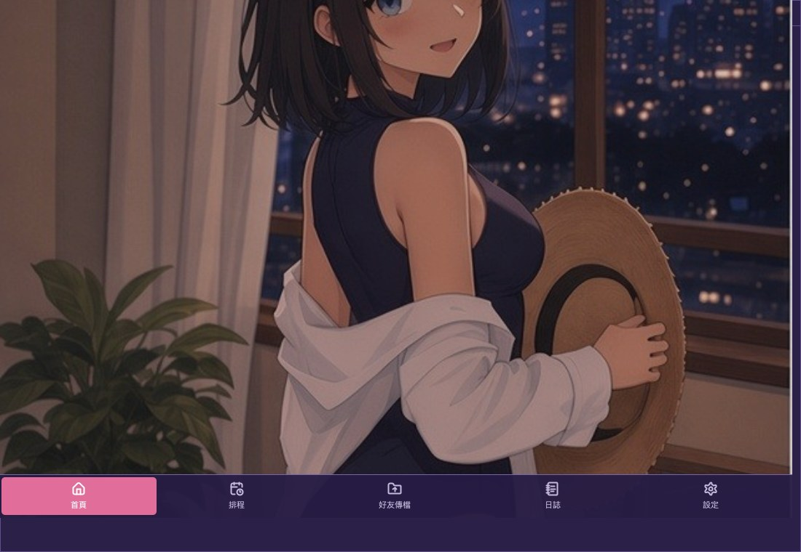
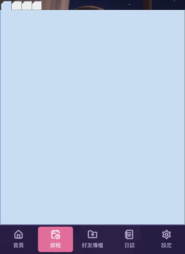
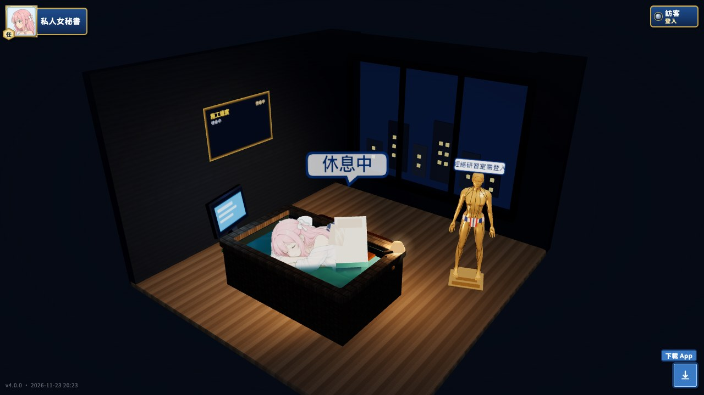
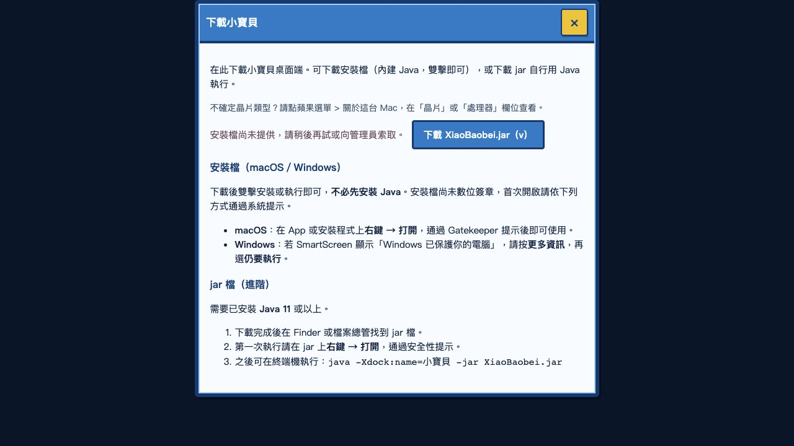
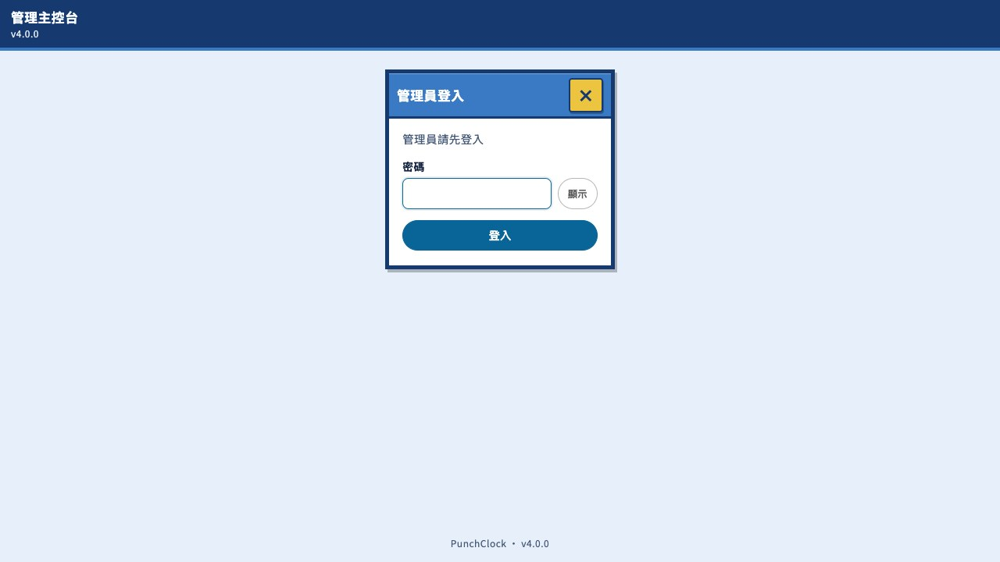
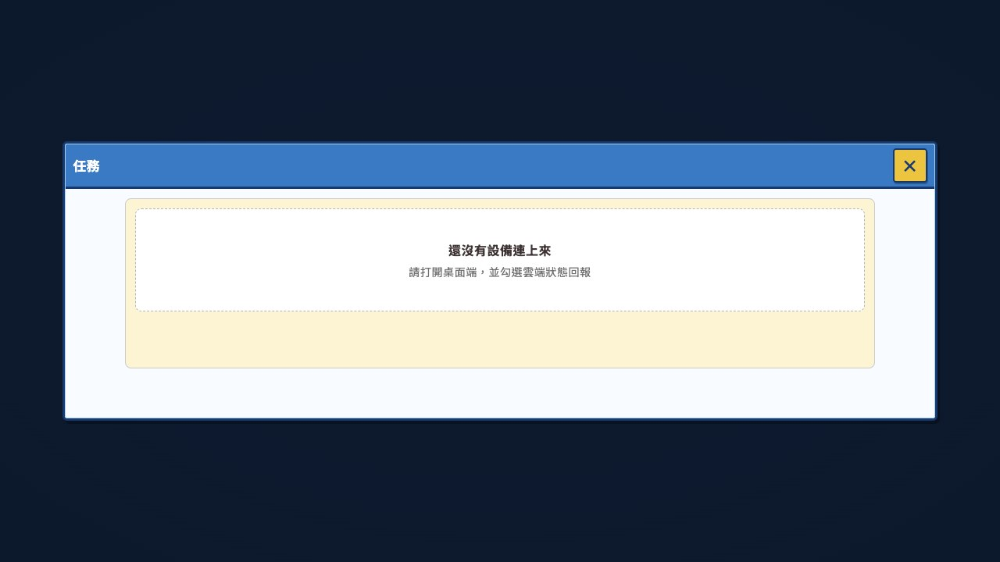
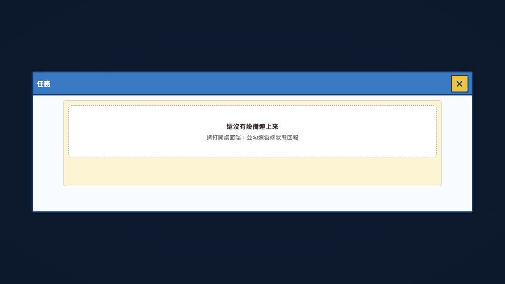
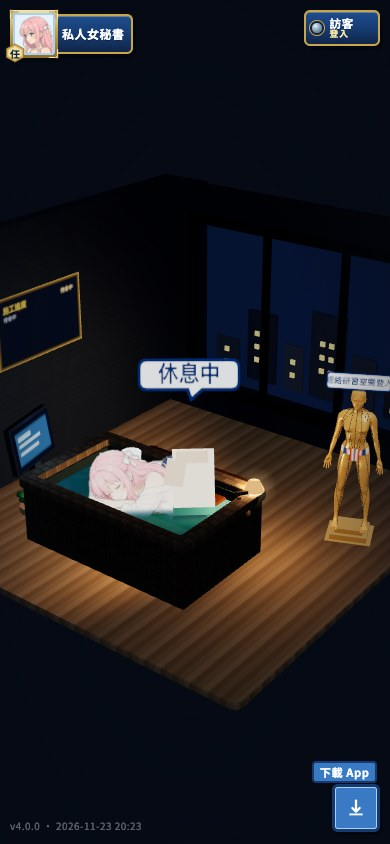

# PunchClock

小寶貝（PunchClock）由 Java 桌面端與 Javalin 伺服器組成：公開的 2D 虛擬辦公室網站、桌面排程與傳檔、經絡研習室，以及管理主控台。

## 架構

```text
┌─────────────────┐   HTTP 心跳 + Bearer    ┌──────────────────┐   REST 取消指令   ┌─────────────┐
│  桌面端          │ ─────────────────────► │  server          │ ◄─────────────── │  管理主控台   │
│  XiaoBaobei.jar │ ◄── action / actions ── │  (Javalin)       │ ── WS 狀態推送 ─► │  /console   │
└─────────────────┘                        └──────────────────┘                   └─────────────┘
         │                                           │
         │                                           ├── GET /  公開虛擬辦公室
         │                                           ├── /atlas/tcm-3d/  經絡研習室（免登入）
         │                                           └── /download  安裝檔與 jar
```

**通訊協定：** 桌面端走 HTTP 心跳；主控台用 REST 下指令、WebSocket 只推狀態。路由見 [`server/README.md`](server/README.md)。

遠端僅支援「取消全部／取消單一任務」；排程請在桌面端本機建立。

| 模組 | 說明 | 技術 |
| ------ | ------ | ------ |
| [`client/`](client/) | 桌面端：排程、好友傳檔、連線與外觀 | Java 11、Swing、Playwright |
| [`server/`](server/) | 伺服器：心跳、網站、主控台 | Java 11、Javalin、WebSocket |
| [`shared/`](shared/) | 共用程式（`PeerFileRules` 等） | Java 11 |
| [`atlas-src/tcm-3d/`](atlas-src/tcm-3d/) | 經絡研習室靜態站（建置後掛在 server） | Vite、Three.js |

## 快速開始

### 1. 啟動伺服器

```bash
mvn -pl server -am package -DskipTests
java -jar server/target/punchclock-server.jar
```

預設 `http://localhost:3000`。**首頁 `/` 是公開虛擬辦公室**；管理主控台在 `/console`（或先開 `/login`）。

### 2. 啟動桌面端

**前置：** JDK 11+、Maven 3.6+

```bash
mvn -pl client -am package -DskipTests
java -jar client/target/XiaoBaobei.jar
```

首次執行 Playwright 會下載瀏覽器驅動。

### 3. 連線設定

桌面端「設定 → 連線」：

1. 勾選「啟用雲端單向狀態回報」
2. Server 網址，例如 `http://localhost:3000`
3. 心跳 Token 與伺服器 `HEARTBEAT_SECRET` 一致（本機預設 `punchclock-dev-secret`）
4. 「測試連線」確認成功

裝置 ID 在「好友傳檔」分頁（預設 `company-worker`）。

### 4. 公司受限網路

- **SSL 攔截：** 勾選「信任所有 SSL（除錯）」可略過憑證驗證（心跳與中繼共用；啟用雲端時會鎖定）。僅建議在已知有 SSL 攔截的環境使用。
- **Proxy：** 加 `-Djava.net.useSystemProxies=true`，或 `-Dhttps.proxyHost=… -Dhttps.proxyPort=…`。
- **中繼 Proxy：** 「設定」勾選後（預設埠 `8888`），同事把 Server 網址改成 `http://你的IP:8888` 即可轉發。
- **建置抓不到 git-commit plugin：** 命令列加 `-P '!git-commit-time'`，或在網路正常的環境打包 jar 再帶過去。

### 5. 公開網站

- **虛擬辦公室**（`GET /`）：2D 場景。書櫃進入經絡研習室；桌面上的入口可開「下載 App」（`/download`）；白板／告示牌可查看施工進度。
- **經絡研習室**（`/atlas/tcm-3d/`，免登入）：穴位練習用角色模型，搜尋支援穴名、注音或編號。本機須先 `./scripts/build-atlas.sh`（需 Node.js ≥ 22），否則會提示尚未建置。開發檢查與烘焙流程見 `atlas-src/tcm-3d` 目錄內文件。
- **下載頁**（`/download`）：macOS／Windows 安裝檔（若 Release 或環境變數有提供）與 `XiaoBaobei.jar`（仍接受舊檔名 `SKLbaby.jar`）。安裝檔未簽章：macOS 右鍵→打開；Windows SmartScreen「更多資訊」→「仍要執行」。

### 6. 管理主控台

`/login` 登入後進 `/console`（芥末黃／藍色、粗框線）。目前分頁：**任務**、**施工進度**、**辦公室**（連回首頁）。仍為共用管理員密碼（`ADMIN_PASSWORD`）。

## 操作畫面

### 桌面端

視窗標題為產品名「小寶貝」與版號。側欄：**首頁、排程、好友傳檔、日誌、設定**（含連線、外觀、中繼、程式更新）。

| 首頁 | 排程 |
| ------ | ------ |
|  |  |
| 好友傳檔 | 設定（外觀） |
|  |  |
| 日誌 | 迷你模式 |
|  |  |

### 網站（桌機 1280／手機 390）

| 虛擬辦公室 | 經絡研習室 |
| ------ | ------ |
|  |  |
| 下載頁 | 登入 |
|  |  |
| 主控台任務 | 施工進度 |
|  |  |

手機版範例：

## 主要功能

### 桌面端

- 多任務排程（單次／批量週一至週五）、±5 分鐘隨機浮動、編輯與立即執行
- 本機持久化（`~/.punchclock/tasks.json`）
- 外觀：桌布、透明度、**桌面寵物**、**迷你模式**（底欄縮成窄條，不干擾焦點）
- Playwright 支援多種瀏覽器引擎
- 同事傳檔（含資料夾 ZIP）、直傳、一對一聊天
- 中繼 Proxy 轉發雲端請求
- 程式更新：見下方精簡說明

### 伺服器

- 裝置狀態即時時顯示、遠端取消任務
- 傳檔暫存約 6 小時
- 3 分鐘無心跳視為離線
- 登入失敗 5 次鎖定 15 分鐘

### 桌面端自動更新

- 心跳帶 `appVersion`；伺服器快取 GitHub `releases/latest`，有較新版時在「設定 → 程式更新」顯示（預設自動檢查，不跳視窗）。
- 「現在更新」下載到 `~/.punchclock/updates/`，校驗後替換 jar 並重啟；忙碌或即將執行任務時會延後。
- 以 `java -jar` 啟動才適用；安裝版（`.dmg`／`.exe`）改寫入 `~/.sklbaby/app/SKLbaby.jar`，詳見設定頁說明。
- 正式發版需推 `v*` tag 建立 GitHub Release（見 `.github/workflows/package-desktop.yml`）。

## 部署建議

雲端部署 server 後，桌面端填入 HTTPS 網址即可。

**Render（Docker）：** Runtime 選 Docker，`server/Dockerfile`；或使用根目錄 [`render.yaml`](render.yaml)。

| 變數 | 說明 | 預設值 |
| ------ | ------ | -------- |
| `PORT` | 監聽埠 | `3000` |
| `HEARTBEAT_SECRET` | 心跳 Bearer | `punchclock-dev-secret` |
| `ADMIN_PASSWORD` | 主控台密碼 | `secret` |
| `PUNCHCLOCK_GITHUB_TOKEN` | 選填；Release 查詢與施工進度 API | （空） |

生產環境請修改 `HEARTBEAT_SECRET` 與 `ADMIN_PASSWORD`。

## 開發

```bash
mvn test
mvn -pl client -am test
mvn -pl server -am test
```

VS Code：`.vscode/launch.json` 的 **App (desktop)**、**Server (Javalin)**。